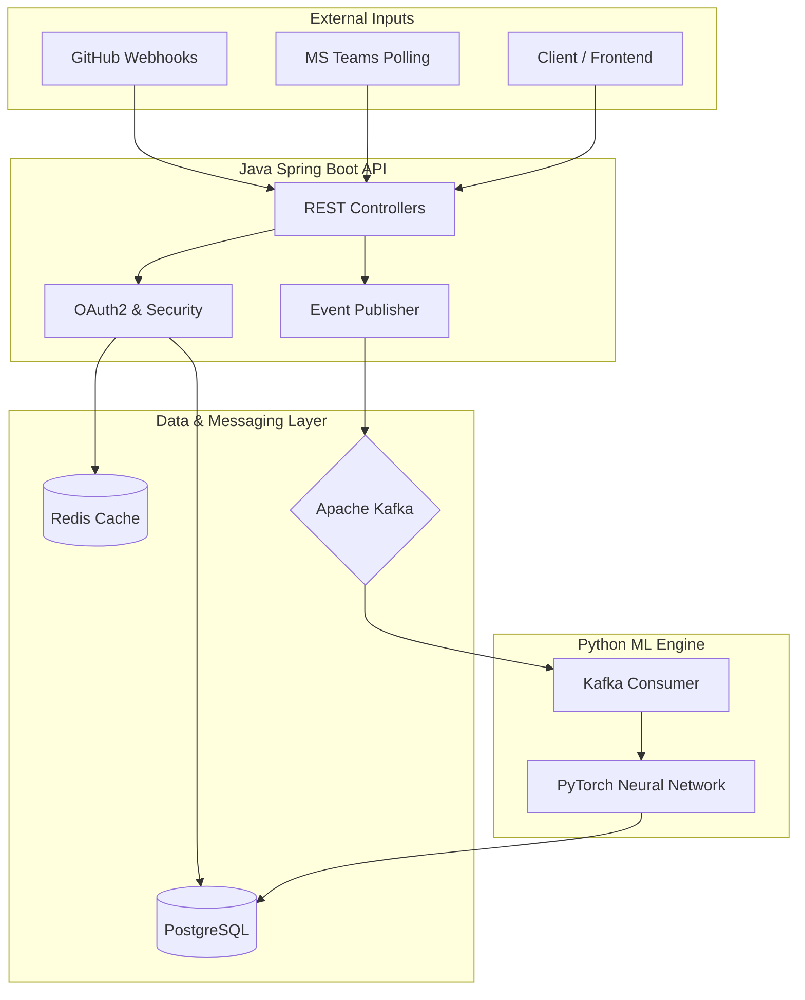
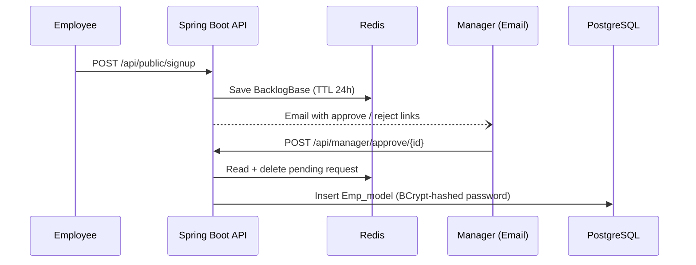

<div align="center">

# Employeger
### AI-Driven Employee Management & Performance Telemetry System

**Transforming raw developer activity and communication metadata into objective, AI-calculated performance metrics.**


[Architecture](#-system-architecture) • [Quick Start](#-quick-start) • [API Reference](#-api--usage-examples) • [Roadmap](#-roadmap)

</div>

---

## 📑 Table of Contents
- [Why I Built This](#-why-i-built-this)
- [The Problem Space](#-the-problem-space)
- [System Architecture](#-system-architecture)
- [Engineering Decisions & Trade-offs](#-engineering-decisions--trade-offs)
- [Technology Stack](#-technology-stack)
- [Key Features & Engineering Highlights](#-key-features--engineering-highlights)
- [Project Structure](#-project-structure)
- [Quick Start](#-quick-start)
- [API & Usage Examples](#-api--usage-examples)
- [Testing & Quality](#-testing--quality)
- [Security, Reliability & Scalability](#-security-reliability--scalability)
- [Roadmap](#-roadmap)
- [Contributing](#-contributing)
- [License](#-license)

---

## 🧠 Why I Built This

Employeger was built to treat employee performance as a **real-time telemetry problem**. By integrating directly with the tools developers and teams actually use (GitHub for code, Microsoft Teams for communication), I explored how to build a fault-tolerant data pipeline that ingests webhooks, streams them through Apache Kafka, and processes them via a PyTorch neural network to output objective performance scores in near real-time. The goal was to bridge the gap between a strongly-typed Java enterprise backend and a Python-based ML inference engine without compromising the reliability of either.

---

## 🎯 The Problem Space

### The Problem
Engineering managers struggle to quantify developer productivity objectively. Code commits alone don't show collaboration, and communication metrics alone don't show technical output. Existing tools either track one or the other, or they require manual aggregation.

### Why Existing Approaches Fall Short
- **Manual Aggregation:** Time-consuming and prone to recency bias.
- **Basic Integrations:** Most tools display raw numbers (e.g., "50 commits") without context or normalization.
- **Synchronous Processing:** Calling ML models directly from web APIs introduces unacceptable latency and tight coupling.

### The Engineering Challenge
Building a low-latency, fault-tolerant pipeline that bridges a Java Spring Boot API with a Python PyTorch inference engine. The system must handle out-of-order webhook deliveries, manage OAuth2 token lifecycles securely, and ensure the ML engine can process high-throughput event streams without blocking the core application.

### The Proposed Approach
A decoupled, event-driven architecture. The Java backend acts as the orchestrator and ingestion layer, pushing normalized telemetry events into a Kafka topic. A standalone Python microservice consumes this stream, aggregates state, runs the data through a neural network, and writes the calculated performance scores back to the persistent database.

### Expected Impact
A repeatable, auditable performance signal derived from real work artifacts — reducing review bias and giving employees a transparent, data-backed view of their own contributions.

---

## 🏗️ System Architecture

The system follows a microservices-inspired architecture with a clear separation of concerns between the transactional API and the analytical ML engine.



### Execution Walkthrough: The Telemetry Pipeline
1. **Ingestion:** GitHub sends a `push` or `pull_request` webhook to `/api/webhooks/github`.
2. **Normalization:** The `WebhookController` validates the payload, identifies the employee via their linked GitHub username, and creates an `ActivityEvent`.
3. **Streaming:** The `KafkaProducerService` serializes the event and pushes it to the `employee-activity-stream` Kafka topic.
4. **Processing:** The Python `consumer.py` continuously polls Kafka, deserializes the event, and fetches the employee's accumulated metrics from PostgreSQL.
5. **Inference:** The updated metrics pass through the `PerformanceModel` (PyTorch), which outputs a normalized score (0–100) and a calculated bonus.
6. **Persistence:** The Python engine upserts the new metrics into the `performance_metrics` table, ready for the API to serve.

### Execution Walkthrough: The Approval Workflow



<details>
<summary><strong>🔍 Deep Dive: The Redis Approval Backlog Pattern</strong></summary>

To prevent database bloat and enforce time-bound approvals, pending requests (Signups, Leave) are not written to PostgreSQL immediately. They are stored in Redis using `@RedisHash` with a 24-hour Time-To-Live (`@TimeToLive`). If a manager does not act within 24 hours, the request automatically expires and is evicted from memory — no cron jobs, no stale rows, no manual cleanup.

</details>

<details>
<summary><strong>🔍 Deep Dive: Why Kafka Sits Between Java and Python</strong></summary>

Direct HTTP calls from the Java API to the Python ML engine would couple their lifecycles: a Python restart would drop telemetry, and slow inference would inflate API latency. Kafka decouples them. The Java side produces events and returns immediately; the Python side consumes at its own pace. If the ML engine is offline, events simply accumulate in the topic and are replayed when it recovers — no data loss, no backpressure on the API.

</details>

---

## ⚖️ Engineering Decisions & Trade-offs

| Engineering Decision | Why It Was Chosen | Alternative | Trade-off |
| :--- | :--- | :--- | :--- |
| **Java + Python hybrid** | Java excels at enterprise security, RBAC, and transactional APIs; Python is the native ecosystem for PyTorch. | Pure Java (DJL / ONNX) or pure Python (FastAPI). | Two runtimes to build, deploy, and monitor. |
| **Kafka for the ML pipeline** | Decouples API from ML engine; guarantees no telemetry loss during Python restarts. | Direct synchronous HTTP calls. | Requires running and maintaining a Kafka broker. |
| **Redis for approval backlog** | Automatic TTL expiry for pending requests without polling or cleanup jobs. | PostgreSQL `expires_at` column + scheduler. | Extra infrastructure component; data is ephemeral by design. |
| **OAuth2 Authorization Code Flow** | Links external accounts without ever touching user passwords or long-lived API keys. | Personal Access Tokens (PATs). | Requires callback handling, state management, and redirect URI configuration. |
| **HTTP Basic Auth + BCrypt** | Simple, stateless authentication suited to an API-first backend during early development. | JWT sessions or OAuth2 login for the portal itself. | Basic Auth requires TLS in production and offers no token revocation; JWT is the planned upgrade. |
| **Scheduled polling for Teams** | Microsoft Graph change-notification subscriptions require public HTTPS endpoints and validation handshakes. | Graph API webhooks (change notifications). | Polling introduces up-to-10-minute latency for Teams responsiveness metrics. |

---

## 🛠️ Technology Stack

| Layer | Technology | Responsibility |
| :--- | :--- | :--- |
| **Core API** | Java 21, Spring Boot 3.5 | REST endpoints, RBAC security, OAuth2 flows, background scheduling |
| **Persistence** | PostgreSQL + Spring Data JPA | Relational storage for Employees, Managers, Performance Metrics |
| **Caching** | Redis + Spring Data Redis | Ephemeral backlog for pending approvals (24h TTL) |
| **Messaging** | Apache Kafka + spring-kafka | Asynchronous event streaming between Java and Python |
| **ML Engine** | Python 3.9, PyTorch 2.1 | Telemetry aggregation and neural-network inference |
| **DB Access (ML)** | psycopg2 | Upsert of computed metrics from the Python consumer |
| **Email** | Spring Mail (JavaMailSender) | Manager approval notifications |
| **Build** | Maven (wrapper), pip + venv | Reproducible builds for both runtimes |

---

## ✨ Key Features & Engineering Highlights

### Key Features
- **Role-Based Access Control (RBAC):** Strict separation of Employee and Manager endpoints via Spring Security filter chains.
- **Automated Approval Workflows:** Email-driven manager approvals for onboarding and leave requests, backed by a self-expiring Redis backlog.
- **Seamless Integrations:** One-click OAuth2 linking for GitHub and Microsoft Teams accounts.
- **Real-Time Telemetry:** GitHub webhooks capture commits and PR outcomes; a scheduled service polls Teams activity.
- **AI Performance Scoring:** A PyTorch feedforward network converts accumulated activity into a 0–100 score and a bonus figure.

### Engineering Highlights
- **Asynchronous event bus:** Spring's `ApplicationEventPublisher` + `@Async` listeners decouple HTTP request latency from email delivery.
- **Graceful degradation:** If the ML engine is offline, the Java API keeps serving; events buffer in Kafka until the consumer recovers.
- **Constructor injection everywhere:** All services use constructor-based dependency injection for testability and immutable dependencies.
- **Safe credential handling:** Passwords are BCrypt-hashed at approval time; OAuth tokens are stored server-side and never exposed to clients.

---

## 📂 Project Structure

```text
Employee-management_Backend/
├── src/main/java/com/example/employeger/
│   ├── config/          # SecurityConfig, KafkaProducerConfig
│   ├── controller/      # Public, Employee, Manager, Integration, Webhook, Performance controllers
│   ├── event/           # EmployeeEvent + EmployeeEventListener (async email triggers)
│   ├── model/           # JPA entities (Emp_model, Man_model, PerformanceMetrics) + Redis entity (BacklogBase)
│   ├── repository/      # Spring Data JPA & Redis repository interfaces
│   ├── service/         # Business logic: approvals, OAuth, email, Teams polling, Kafka producer
│   ├── EmployegerApplication.java
│   └── ServletInitializer.java
├── src/main/resources/
│   └── application.properties   # DB, Redis, Kafka-adjacent and OAuth configuration
├── ml-engine/                   # Python microservice (PyTorch ML engine)
│   ├── config.py                # Env loading (python-dotenv)
│   ├── consumer.py              # Kafka consumer loop
│   ├── database.py              # PostgreSQL upsert logic (psycopg2)
│   ├── model.py                 # PyTorch PerformanceModel
│   ├── main.py                  # Entry point
│   └── requirements.txt
└── pom.xml
```

---

## 🚀 Quick Start

### Prerequisites
- **Java 21** and **Maven** (or use the bundled `./mvnw` wrapper)
- **Python 3.9+**
- **Docker** (for PostgreSQL, Redis, and Kafka)
- OAuth credentials from **GitHub Developer Settings** and the **Microsoft Azure Portal**

### 1. Infrastructure Setup
```bash
# PostgreSQL
docker run -d --name postgres -e POSTGRES_PASSWORD=Abcd -e POSTGRES_DB=employeger_db -p 5432:5432 postgres:15

# Redis
docker run -d --name redis -p 6379:6379 redis:7

# Kafka
docker run -d --name kafka -p 9092:9092 apache/kafka:latest
```

### 2. Environment Configuration
All Java-side configuration lives in `src/main/resources/application.properties`:

| Key | Purpose | Required | Example |
| :--- | :--- | :--- | :--- |
| `spring.datasource.url` | PostgreSQL JDBC URL | Yes | `jdbc:postgresql://localhost:5432/employeger_db` |
| `spring.datasource.username` / `password` | DB credentials | Yes | `postgres` / `<your-password>` |
| `spring.data.redis.host` / `port` | Redis connection | Yes | `localhost` / `6379` |
| `github.client-id` / `github.client-secret` | GitHub OAuth app | For integrations | `<from GitHub Developer Settings>` |
| `github.redirect-uri` | GitHub OAuth callback | For integrations | `http://localhost:8080/api/integration/github/callback` |
| `microsoft.client-id` / `microsoft.client-secret` | Azure AD app | For integrations | `<from Azure Portal>` |
| `microsoft.redirect-uri` | Microsoft OAuth callback | For integrations | `http://localhost:8080/api/integration/microsoft/callback` |

The Python engine reads optional overrides from `ml-engine/.env` (sane defaults apply if absent):

| Variable | Purpose | Default |
| :--- | :--- | :--- |
| `KAFKA_BOOTSTRAP_SERVERS` | Kafka broker address | `localhost:9092` |
| `KAFKA_TOPIC` | Telemetry topic | `employee-activity-stream` |
| `DB_HOST` / `DB_PORT` / `DB_NAME` / `DB_USER` / `DB_PASSWORD` | PostgreSQL for metric upserts | `localhost` / `5432` / `employeger_db` / `postgres` / `Abcd` |

> ⚠️ Never commit real secrets. Keep credentials local or inject them via your environment.

### 3. Run the Java Backend
```bash
./mvnw spring-boot:run
```
The API starts on `http://localhost:8080`. Hibernate (`ddl-auto=update`) creates the schema on first boot.

### 4. Run the Python ML Engine
```bash
cd ml-engine
python3 -m venv venv
source venv/bin/activate        # Windows: venv\Scripts\activate
pip install -r requirements.txt
python main.py
```
Expected console output: `[KAFKA] Starting consumer on topic: employee-activity-stream`.

### Verification
```bash
# Server + security chain are live (expect HTTP 401 Unauthorized without credentials)
curl -i http://localhost:8080/api/performance/my-stats

# Simulate a GitHub commit webhook (replace with a linked GitHub username)
curl -X POST http://localhost:8080/api/webhooks/github \
  -H "Content-Type: application/json" \
  -H "X-GitHub-Event: push" \
  -d '{ "sender": { "login": "your-github-username" } }'
```
Then watch the ML engine console print `[EVENT] Received: COMMIT ...` followed by a `[DB] Updated performance ...` line.

### Troubleshooting
| Symptom | Cause | Fix |
| :--- | :--- | :--- |
| `zsh: command not found: pip` (macOS) | System Python exposes `pip3`, not `pip` | Use `python3 -m pip ...` or activate a venv first |
| IDE shows `Unresolved reference: kafka / torch` | IDE interpreter ≠ install interpreter | Point the IDE to `ml-engine/venv/bin/python` |
| `Permission denied` deleting/creating `venv` on macOS | Read-only/locked files (common in `~/Downloads`) | `chflags -R nouchg venv && chmod -R u+w venv && rm -rf venv`, then recreate |
| `UserWarning: Failed to initialize NumPy` | Torch installed without NumPy | `pip install numpy==1.26.4` |
| Kafka connection refused | Broker not running | Verify `docker ps` shows the kafka container on port 9092 |

---

## 🔌 API & Usage Examples

| Method | Endpoint | Access | Description |
| :--- | :--- | :--- | :--- |
| `POST` | `/api/public/signup` | Public | Submit a new employee registration request |
| `POST` | `/api/employee/leave` | Employee | Submit a leave request for manager approval |
| `POST` | `/api/manager/approve/{requestId}` | Manager | Approve a pending signup or leave request |
| `POST` | `/api/manager/reject/{requestId}` | Manager | Reject and discard a pending request |
| `GET` | `/api/integration/github/initiate` | Employee | Returns the GitHub OAuth authorization URL |
| `GET` | `/api/integration/github/callback` | Public | OAuth redirect target; stores token + username |
| `GET` | `/api/integration/microsoft/initiate` | Employee | Returns the Microsoft OAuth authorization URL |
| `GET` | `/api/integration/microsoft/callback` | Public | OAuth redirect target; stores Teams token |
| `POST` | `/api/webhooks/github` | Public | Ingests commit / PR events from GitHub |
| `GET` | `/api/performance/my-stats` | Employee | Returns AI-calculated score and bonus |

> Authentication uses HTTP Basic with the **Employee/Manager ID as the username**.

### Submit a signup request
```bash
curl -X POST http://localhost:8080/api/public/signup \
  -H "Content-Type: application/json" \
  -d '{
    "employeeName": "Jane Doe",
    "employeeEmail": "jane@example.com",
    "password": "SecurePass123!",
    "Manager_name": "manager@company.com"
  }'
```

### Submit a leave request (authenticated)
```bash
curl -u <EMPLOYEE_ID>:<PASSWORD> \
  -X POST http://localhost:8080/api/employee/leave \
  -H "Content-Type: application/json" \
  -d '{
    "leaveReason": "Family function",
    "Manager_name": "manager@company.com"
  }'
```

### View AI performance stats (authenticated)
```bash
curl -u <EMPLOYEE_ID>:<PASSWORD> http://localhost:8080/api/performance/my-stats
```

---

## 🧪 Testing & Quality

The project currently relies on **manual integration testing** (curl/Postman against a locally running stack). This is an honest limitation, not an oversight — the priority so far has been architectural correctness.

**Planned testing infrastructure:**
- **JUnit 5 + Mockito** for service-layer unit tests (approval logic, OAuth token exchange).
- **Testcontainers** for ephemeral PostgreSQL/Redis/Kafka in integration tests.
- **PyTest** for the ML engine (tensor normalization, upsert idempotency).
- **spring-kafka-test** (already in `pom.xml`) for embedded broker tests.

---

## 🛡️ Security, Reliability & Scalability

### Implemented safeguards
- **Password hashing:** BCrypt at approval time; plaintext passwords never persisted.
- **OAuth2 `state` parameter:** Carries the employee ID through the redirect flow, preventing tampered callbacks.
- **RBAC enforcement:** `/api/employee/**` and `/api/manager/**` are role-gated in the security filter chain.
- **Self-expiring state:** Redis TTL guarantees pending requests cannot linger indefinitely.
- **Buffered processing:** Kafka retains telemetry during ML-engine downtime (no data loss).

### Areas requiring hardening (documented honestly)
- **Webhook signature verification:** GitHub HMAC SHA-256 validation (`X-Hub-Signature-256`) is not yet enforced.
- **Rate limiting:** Public endpoints (`/api/public/**`, `/api/webhooks/**`) are currently unthrottled.
- **CORS:** Disabled for local development; must be restricted to the frontend origin in production.
- **Transport security:** TLS termination is assumed at the deployment layer; Basic Auth must never run over plain HTTP in production.

### Scalability posture
The API tier is stateless (Basic Auth, no server sessions) and scales horizontally. The Kafka topic allows multiple ML consumer instances in a consumer group for parallel processing. PostgreSQL remains the single source of truth and is the first candidate for read-replica scaling as dashboards grow.

---

## 🗺️ Roadmap

- [x] Core RBAC and manager approval workflow (Redis backlog + email)
- [x] OAuth2 account linking (GitHub, Microsoft Teams)
- [x] Telemetry pipeline (GitHub webhooks, Teams polling, Kafka streaming)
- [x] PyTorch inference engine with PostgreSQL metric persistence
- [ ] Classic frontend dashboard (React) to visualize telemetry and bonuses
- [ ] HMAC signature verification for GitHub webhooks
- [ ] JWT-based session tokens to replace Basic Auth
- [ ] Train the PyTorch model on historical activity data instead of random initialization
- [ ] Automated test suite (JUnit 5, Testcontainers, PyTest)

---

## 🤝 Contributing

This project is maintained as an architectural demonstration and portfolio piece, but contributions are welcome:

1. Fork the repository.
2. Create a feature branch: `git checkout -b feature/amazing-feature`.
3. Start the local stack (PostgreSQL, Redis, Kafka) and verify your change end-to-end.
4. Commit with a clear message: `git commit -m 'Add amazing feature'`.
5. Push and open a Pull Request.

**Conventions:** constructor injection only, no secrets in commits, keep controllers thin and services focused.

---

## 📜 License

No license has been specified for this project yet. All rights are reserved by the author until a license file is added.

---

<div align="center">
  <sub>Built with engineering rigor. Designed for scale.</sub>
</div>
